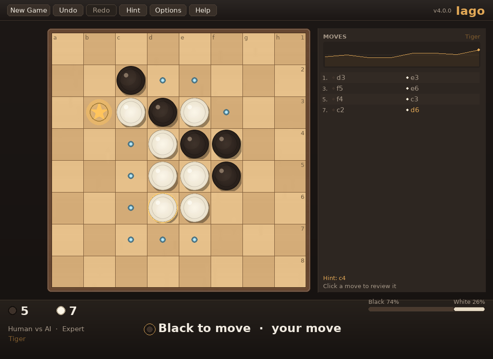
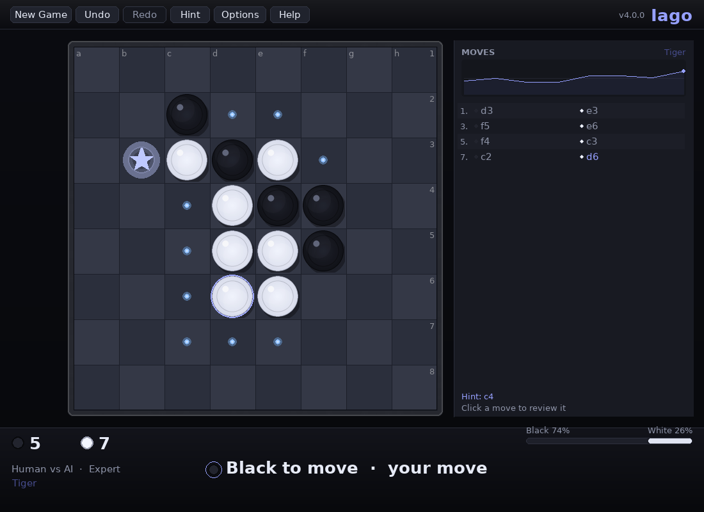
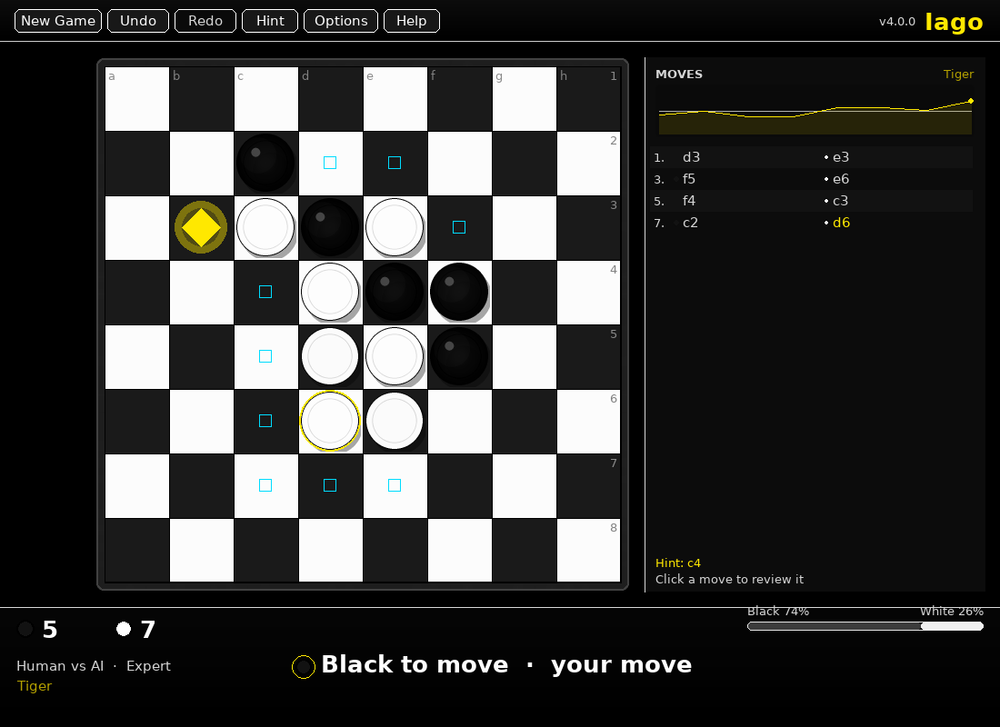
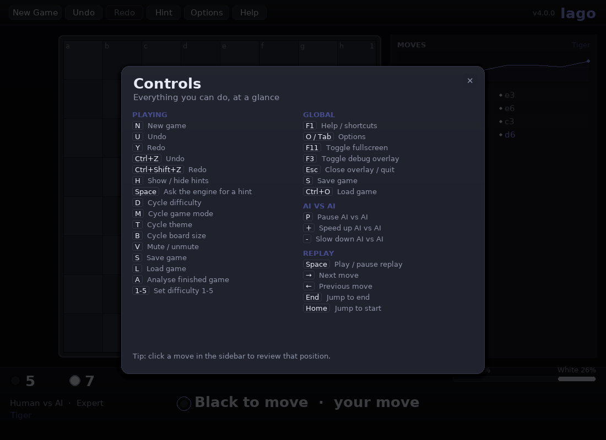

# Iago

**Reversi, refined.** A polished Reversi (Othello) game for the desktop, written in
Python and pygame: a real search engine with five difficulty levels, a modern themed
interface with a responsive layout, and a full record of everything you play.


<p align="center">
  <a href="https://github.com/James-HoneyBadger/Iago_Deluxe/actions/workflows/ci.yml"></a>
  
  
  
</p>

---

## Highlights

### A real engine, not a heuristic

- **Bitboard position** with shift-and-mask move generation — roughly **280 000 move
  generations per second** in pure Python.
- **Alpha-beta search** with principal-variation search, a Zobrist transposition table,
  aspiration windows, iterative deepening, killer/history move ordering and a principal
  variation.
- **Exact endgame solver**: once the board is nearly full the engine solves the game to
  the last disc instead of guessing.
- **Five levels**, from a random-move Easy to a tournament-strength Master, validated by
  self-play (Master beats Expert 5–1; every level beats the one below it).

### An interface that feels finished

- **Seven themes** — Classic felt, Walnut, Ocean, Sunset, Forest, Midnight and a
  colour-blind-safe High Contrast mode with distinct marker shapes.
- **Supersampled graphics**: anti-aliased discs with specular highlights, procedural
  felt/wood textures, soft shadows and a bevelled frame.
- **Animation with weight**: 3-D disc flips that ripple outward, particle bursts,
  smooth score counters, screen shake on big captures, floating toasts.
- **Responsive layout**: resize the window, go fullscreen (F11), scale the UI; the
  sidebar collapses automatically on narrow windows.
- **Never freezes**: the engine searches on a worker thread with a live
  depth/nodes/nps readout.
- **Everything is keyboard-accessible** (press **F1** for the full list).

### A record of your play

- **Move list** with algebraic notation, opening names (Tiger, Cat, Horse, Rabbit…),
  and an evaluation graph.
- **Post-game review**: every move rated Best / Good / Inaccuracy / Mistake / Blunder,
  with accuracy percentages and the key moments of the game.
- **Statistics and achievements** persisted between sessions.
- **Save / load / autosave** with versioned, validated JSON and migration from Iago 3.0
  files.

---

## Quick start

```bash
git clone https://github.com/James-HoneyBadger/Iago_Deluxe.git
cd Iago_Deluxe
./play.sh
```

`play.sh` creates a virtual environment on first run, installs the game and launches it.
Any arguments are forwarded:

```bash
./play.sh --theme midnight --level 5
./play.sh --mode ava --size 10 --fullscreen
./play.sh --help
```

Prefer a normal install?

```bash
python -m pip install .
iago                      # console script
python -m iago            # module entry point
```

**Requirements:** Python 3.10 – 3.14 and [`pygame-ce`](https://pypi.org/project/pygame-ce/)
(installed automatically). Plain `pygame` 2.6.1 has an upstream import bug on Python 3.14
that disables all text rendering, which is why this project depends on the maintained
community edition.

---

## Controls

| Key | Action |
|---|---|
| **Left click** | Play a move (dots show legal moves, ★ the engine's suggestion) |
| **Click a move in the sidebar** | Review that position |
| **N** / **R** | New game |
| **U** / **Ctrl+Z** | Undo (undoes the engine's reply too) |
| **Y** / **Ctrl+Y** | Redo |
| **H** | Show/hide hints |
| **Space** | Ask the engine for a hint |
| **D** / **1–5** | Cycle or set difficulty |
| **M** | Cycle game mode |
| **T** | Cycle theme |
| **B** | Cycle board size (6×6 / 8×8 / 10×10) |
| **V** | Mute/unmute |
| **S** / **Ctrl+S** | Save game |
| **L** / **Ctrl+O** | Load game |
| **A** | Analyse a finished game |
| **F1** | Controls |
| **O** / **Tab** | Options |
| **F11** | Fullscreen |
| **F3** | Debug overlay |
| **Esc** | Close overlay / quit (autosaves) |

In replay: **Space** plays/pauses, **←**/**→** step, **Home**/**End** jump.
In AI vs AI: **P** pauses, **+**/**-** change the speed.

---

## Difficulty

| Level | Name | Search | Head-to-head |
|---|---|---|---|
| 1 | **Easy** | Random legal move | — |
| 2 | **Medium** | One-ply evaluation with deliberate noise | 8–0 vs Easy |
| 3 | **Hard** | 0.6 s iterative deepening + opening book | 6–0 vs Medium |
| 4 | **Expert** | 2.5 s, transposition table, exact endgames | 4–0 vs Hard |
| 5 | **Master** | 5 s, deeper endgame solves | 5–1 vs Expert |

Reproduce with `python scripts/selfplay.py --a 5 --b 4 --games 6 --time-scale 0.15`.

---

## Themes

| Classic | Walnut |
|---|---|
|  |  |

| Midnight | High Contrast |
|---|---|
|  |  |

All themes: `./play.sh --list-themes`.

---

## Options, statistics and review

| Options | Statistics |
|---|---|
|  |  |

| Post-game review | Controls |
|---|---|
|  |  |

---

## Where your data lives

| Platform | Location |
|---|---|
| Linux | `~/.local/share/iago/` (or `$XDG_DATA_HOME/iago`) |
| macOS | `~/Library/Application Support/iago/` |
| Windows | `%APPDATA%\iago\` |

Override with `--data-dir PATH` or the `IAGO_DATA_DIR` environment variable. Files:
`settings.json`, `stats.json`, `autosave.json`, `saved_game.json` and `iago.log`.
See [docs/SAVE_FORMAT.md](docs/SAVE_FORMAT.md) for the schemas.

---

## Project layout

```
Iago_Deluxe/
├── src/iago/
│   ├── core/        # constants, bitboard, reference Board, notation
│   ├── ai/          # evaluation, search, endgame solver, book, engine, worker
│   ├── ui/          # theme, layout, assets, drawing, animation, widgets, HUD, overlays
│   ├── app/         # controller, session, settings, persistence, audio, analysis, keymap
│   ├── util/        # logging and the exception hierarchy
│   ├── branding.py  # app name, version, tagline
│   └── cli.py       # argument parsing and entry point
├── tests/           # 330 tests, all headless
├── scripts/         # benchmark, self-play, book builder, screenshot generator
└── docs/            # user guide, architecture, AI design, save format, changelog
```

## Development

```bash
./setup.sh                    # venv + editable install + test run
.venv/bin/pytest -q           # 330 tests
.venv/bin/black src tests     # formatting
.venv/bin/flake8 src tests    # lint
.venv/bin/mypy src/iago       # types
.venv/bin/pylint src/iago     # static analysis
```

CI runs the suite on Linux, macOS and Windows across Python 3.10 – 3.14, and gates on
formatting, lint, types, pylint and a wheel build.

---

## Documentation

- [User guide](docs/USER_GUIDE.md) — every screen, control and feature
- [Architecture](docs/ARCHITECTURE.md) — modules, data flow, threading, rendering
- [AI design](docs/AI_DESIGN.md) — bitboards, evaluation, search, endgames, benchmarks
- [Development](docs/DEVELOPMENT.md) — setup, tests, packaging, extension points
- [Save format](docs/SAVE_FORMAT.md) — JSON schemas and migrations
- [Changelog](docs/CHANGELOG.md) — what changed in 4.0

## License

MIT — see [LICENSE](LICENSE). © 2025 Honey Badger Universe.
