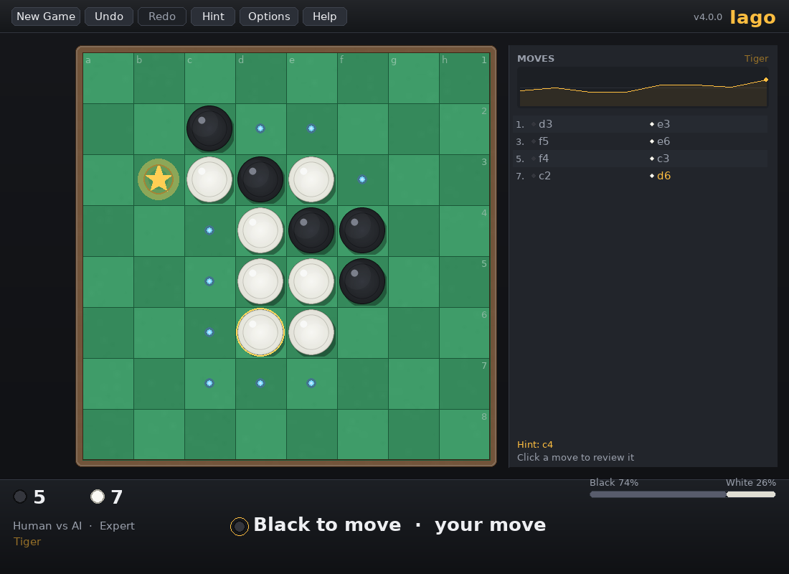
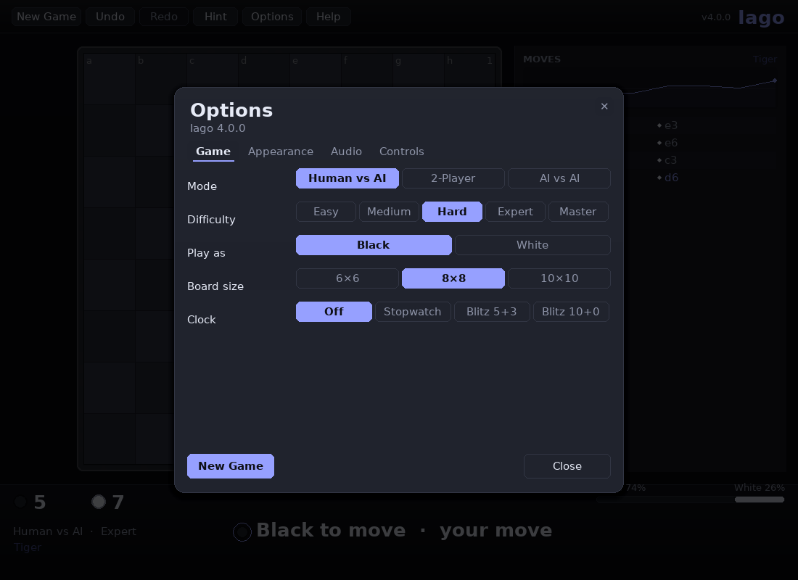
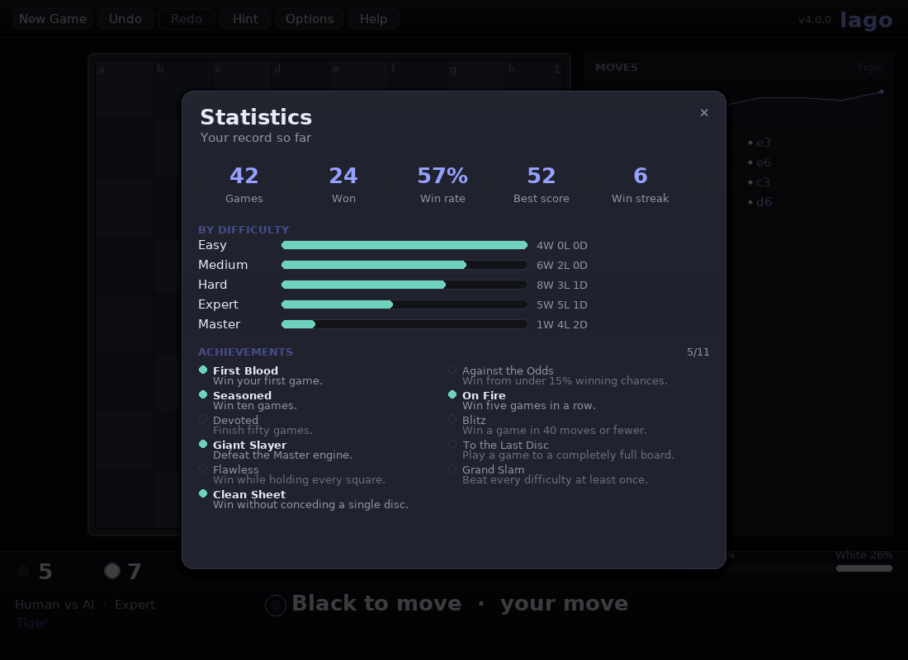
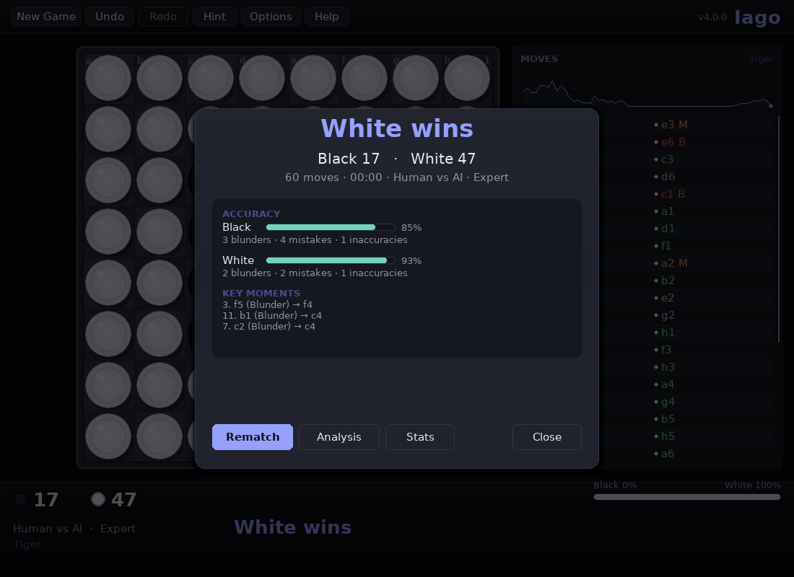

# Iago — User Guide

Everything the game can do, screen by screen. New to Reversi? Read
[How Reversi works](#how-reversi-works) first.

- [Starting the game](#starting-the-game)
- [The window](#the-window)
- [How Reversi works](#how-reversi-works)
- [Playing](#playing)
- [Undo and redo](#undo-and-redo)
- [Game modes](#game-modes)
- [Difficulty](#difficulty)
- [Hints and analysis](#hints-and-analysis)
- [Reading the sidebar](#reading-the-sidebar)
- [Options](#options)
- [Statistics and achievements](#statistics-and-achievements)
- [Post-game review](#post-game-review)
- [Clocks](#clocks)
- [Saving, loading and resuming](#saving-loading-and-resuming)
- [Where your data lives](#where-your-data-lives)
- [Keyboard reference](#keyboard-reference)
- [Command line](#command-line)
- [Troubleshooting](#troubleshooting)

---

## Starting the game

```bash
./play.sh                 # sets everything up on first run, then launches
```

Other ways to start it:

```bash
.venv/bin/python -m iago      # module entry point
.venv/bin/iago                # installed console script
python main.py                # compatibility shim
```

The first launch creates a virtual environment, installs `pygame-ce` and starts the
game. Subsequent launches are immediate. `./play.sh` forwards its arguments, so
`./play.sh --theme midnight --level 5` works too.

Requirements: Python 3.10–3.14 and `pygame-ce` 2.5.4 or newer.

---

## The window



| Area | What it shows |
|---|---|
| **Menu bar** (top) | New Game · Undo · Redo · Hint · Options · Help, plus your saved record |
| **Board** | The 6×6, 8×8 or 10×10 grid, framed in wood, with coordinates on the edges |
| **Sidebar** (wide windows) | Opening name, evaluation graph, full move list, hint and review summary |
| **Status bar** (bottom) | Disc counts, mode, difficulty, whose turn it is, clocks, win probability |
| **Overlays** | Options, Controls, Statistics, Game over and Resume prompts |

The layout is responsive. Narrow the window and the sidebar folds away; resize freely,
press **F11** for fullscreen, and use **Appearance → Interface scale** if everything is
too small or too large. The window title always names the mode, the difficulty and the
theme.

### Board furniture

- **Dots** — legal moves for the side to move.
- **★ gold star** — the engine's suggested move (recomputed instantly after each move).
- **Gold ring** — the square played last; it pulses gently.
- **Tinted squares** — the discs that would flip if you played the square under the
  cursor.
- **Ghost disc** — a translucent preview of the disc you are about to place.
- **High Contrast theme** replaces dots and stars with a hollow square and a diamond, so
  the markers stay distinguishable without relying on colour.

### Toasts

Short-lived messages in the top-right corner report passes, saves, loads, achievement
unlocks and errors. They never block play.

---

## How Reversi works

Reversi is played on an even-sized grid — Iago offers 6×6, 8×8 and 10×10. Four discs
form the starting cross in the middle, with **Black moving first**.

To play a move you must **sandwich at least one line of the opponent's discs** between
the disc you place and one of your own, in any of the eight directions. Every sandwiched
disc flips to your colour. Legal moves are shown as dots; a square that would flip
nothing is not legal.

If a side has no legal move it **passes** — Iago does this automatically and tells you.
The game ends when **neither** side can move: usually a full board, sometimes earlier
when one colour has been wiped out. More discs wins; equal discs is a draw.

Squares are named with the usual algebraic scheme: columns `a`–`h` (`a`–`j` on 10×10),
rows `1`–`8` counted from the top. The opening diagonal `d3 c3 f3 e3` is shown as
**Diagonal** in the sidebar, and the standard lines have their usual names (Tiger, Cat,
Horse, Rabbit, Bull, Raccoon).

Strategy in one paragraph: corners can never be flipped, so they are gold; the squares
diagonally next to a corner (X-squares) hand that corner to your opponent, so they are
poison until the corner is taken; and holding *few* discs is usually an advantage early,
because your opponent then has fewer targets. The evaluation bar and the review exist to
show you how those ideas play out move by move.

---

## Playing

1. Click any square marked with a dot. The disc is placed, captured discs flip outward
   from the square, and play passes to the other side.
2. If a side has no legal move, the turn is passed automatically and a toast tells you so.
3. The game ends when neither side can move. The result panel shows the winner and the
   final disc count.

Illegal clicks are rejected with a short buzz and a small shake — nothing changes on the
board. While the engine thinks you can keep interacting: resize, open Options, or press
**U** to abandon the search and take the move back.

---

## Undo and redo

**U** (or **Ctrl+Z**) steps back one *round* when you play against the engine: it undoes
the engine's reply as well as your move, so you are always returned to your own turn.
**Y** (or **Ctrl+Y**, or **Ctrl+Shift+Z**) redoes one move at a time. Undo and redo are
unlimited and restore the clocks as well as the position.

Undo also cancels any search that is still running, and the hint marker is recomputed for
the restored position.

---

## Game modes

| Mode | Description |
|---|---|
| **Human vs AI** | You against the engine. Choose your colour in Options; the engine takes the other side. |
| **2-Player** | Two humans share the keyboard and mouse. |
| **AI vs AI** | Watch two engines play. **P** pauses, **+**/**-** change the speed (Instant → Fast → Normal → Slow). |

Switch modes with **M** or from **Options → Game**. Changing the mode starts a new game.
Statistics are recorded for Human vs AI games only.

---

## Difficulty

| Level | Name | Thinking time | What it does |
|---|---|---|---|
| 1 | Easy | instant | Plays a random legal move. |
| 2 | Medium | instant | One-ply look-ahead with deliberate noise — beatable but not silly. |
| 3 | Hard | 0.6 s | Full alpha-beta search plus the opening book. |
| 4 | Expert | 2.5 s | Transposition table, deeper search, exact endgame solving. |
| 5 | Master | 5 s | Tournament settings; solves more of the endgame perfectly. |

Change it with **D** (cycle), **1**–**5** (direct) or Options. Changing difficulty applies
immediately, even mid-game: the next search simply uses the new budget.

While the engine thinks, the status bar shows its live search depth, node count and nodes
per second, with an animated ellipsis, and the window stays fully responsive.

The levels are genuinely ordered: self-play over hundreds of games has Master beating
Expert, Expert beating Hard, and so on. See
[AI_DESIGN.md](AI_DESIGN.md#strength-validation) for the numbers.

---

## Hints and analysis

- **H** toggles the move markers (dots and star).
- **Space** asks the engine for a stronger suggestion; the result appears as the gold star
  and in the sidebar as `Hint: c4`. Hints are also recomputed cheaply after every move,
  so the star is current without pressing anything.
- **A** runs a full review of the game at any time — mid-game it reviews the moves played
  so far.

---

## Reading the sidebar

| Element | Meaning |
|---|---|
| **Opening name** (top right) | The named line the game has followed, or its opening family. |
| **Evaluation graph** | Black's winning probability after every move, drawn as a filled area. High is good for Black. |
| **Move list** | One row per move: ply number, a coloured disc marker for the side, and the notation. |
| **Row colour** | After a review, rows are coloured by rating — green (best) through amber to red (blunder). Mistakes and blunders also get an `M`/`B` suffix. |
| **Footer** | The review summary (accuracy and blunder counts) once a review finishes, otherwise a hint. |

Clicking any row jumps the board to that position; click any board square to return to the
live game. The mouse wheel scrolls a long move list.

---

## Options



Options are grouped in four tabs; every change is saved immediately.

**Game**
- Mode, difficulty, colour (Black / White) and board size (6×6 / 8×8 / 10×10).
- Clock: **Off**, **Stopwatch**, **Blitz 5+3** or **Blitz 10+0**.
- Difficulty applies immediately; mode, colour, board size and clock start a new game.

**Appearance**
- Theme grid (Classic, Walnut, Ocean, Sunset, Forest, Midnight, High Contrast).
- Toggles for animations, particles, board coordinates and the evaluation bar.
- Interface scale slider (0.75× – 1.5×), applied live.

**Audio**
- Sound on/off, volume slider and a **Play test** button.

**Controls**
- The complete, always-current key binding table — the same data the controller uses, so
  it cannot drift out of date.

---

## Statistics and achievements



- Totals: games, wins, win rate, best score and best winning streak.
- A per-difficulty table with a win-rate bar.
- Every achievement with its unlocked state.

Statistics are recorded for Human vs AI games and persist between sessions. Newly
unlocked achievements appear as toasts at the end of a game.

| Achievement | Unlocked by |
|---|---|
| **First Blood** | Win your first game. |
| **Seasoned** | Win ten games. |
| **Devoted** | Finish fifty games. |
| **Giant Slayer** | Defeat the Master engine. |
| **Flawless** | Win while holding every square. |
| **Clean Sheet** | Win without conceding a single disc. |
| **Against the Odds** | Win from under 15 % winning chances. |
| **On Fire** | Win five games in a row. |
| **Blitz** | Win a game in 40 moves or fewer. |
| **To the Last Disc** | Play a game to a completely full board. |
| **Grand Slam** | Beat every difficulty at least once. |

---

## Post-game review



When a game ends, the result panel shows the score, the number of moves, the elapsed time
and the mode. It then analyses the game in the background:

- **Accuracy** for both sides (0–100 %).
- Counts of **blunders**, **mistakes** and **inaccuracies**.
- **Key moments**: the costliest moves, each with the move that should have been played
  instead.
- The sidebar marks every reviewed move with its rating, colour-coded from green (best)
  to red (blunder).

Every move is compared with the engine's best move in the same position and rated by how
much winning probability it gave away:

| Rating | Loses |
|---|---|
| **Best** | up to ½ percentage point |
| **Good** | up to 2 points |
| **Inaccuracy** | up to 5 points |
| **Mistake** | up to 12 points |
| **Blunder** | more than 12 points |

Accuracy is derived from the average loss: a game with no mistakes scores 100 %, and each
point of average loss costs roughly 4 % of accuracy.

Click any move in the sidebar, or use **←**/**→**, to step through the game and see the
position at that point. **Space** plays the game back automatically; **Home**/**End** jump
to the start and the end. A full-game review takes a couple of seconds and never freezes
the interface.

---

## Clocks

Choose **Off**, **Stopwatch**, **Blitz 5+3** or **Blitz 10+0** in Options.

- **Stopwatch** counts up for each side; purely informational.
- **Blitz** counts down from the base time and adds the increment after each move.

Running out of time ends the game and the opponent wins on time. Clock times are shown in
the status bar and turn amber as soon as either side has under 20 seconds left. They are
stored in saves and restored when you load them.

---

## Saving, loading and resuming

- **S** (or **Ctrl+S**) saves to the data directory as `saved_game.json`.
- **L** (or **Ctrl+O**) loads it, rebuilding the position from the recorded moves and
  validating each one.
- The game **autosaves** every ten moves, when a game ends, and when you quit.
- If an autosave exists at start-up you are offered **Resume** or **Start fresh**.

Loading a finished game shows the result panel and the review, and does not count the game
a second time. Save files are versioned and portable between operating systems; Iago 3.0
save files still load. A file that does not describe a legal game — including hand-edited
files with a missing or non-numeric field — is rejected with a message naming the problem
rather than loading a broken position.

---

## Where your data lives

| Platform | Location |
|---|---|
| Linux | `~/.local/share/iago/` (or `$XDG_DATA_HOME/iago`) |
| macOS | `~/Library/Application Support/iago/` |
| Windows | `%APPDATA%\iago\` |

`--data-dir PATH` and the `IAGO_DATA_DIR` environment variable override the *base*
directory, so files land in `PATH/iago/`. To back up your history, copy that folder; to
start completely fresh, delete it (or use `--reset-settings` to ignore the saved
preferences once).

Files: `settings.json`, `stats.json`, `saved_game.json`, `autosave.json` and `iago.log`
(rotated at 512 KB with three backups). The schemas are documented in
[SAVE_FORMAT.md](SAVE_FORMAT.md).

---

## Keyboard reference

Press **F1** in game for this list. A binding that takes a modifier never fires as the
plain key, so **Ctrl+S** saves the game rather than being read as **S**.

| Key | Action | Context |
|---|---|---|
| Click | Play / inspect | always |
| Mouse wheel | Scroll the move list | sidebar |
| N / R | New game | playing |
| U, Ctrl+Z | Undo | playing |
| Y, Ctrl+Y, Ctrl+Shift+Z | Redo | playing |
| H | Toggle hints | playing |
| Space | Engine hint | playing |
| Space | Play / pause the replay | review |
| D, 1–5 | Difficulty | playing |
| M | Game mode | playing |
| T | Theme | playing |
| B | Board size | playing |
| V | Mute | playing |
| S | Save | playing |
| L | Load | playing |
| S, Ctrl+S | Save | always |
| Ctrl+O | Load | always |
| A | Analyse | playing |
| P | Pause AI vs AI | AI vs AI |
| + / − | AI vs AI speed | AI vs AI |
| ← / → | Step through moves | review |
| Home / End | First / last move | review |
| O / Tab | Options | always |
| F1 | Controls | always |
| F11 | Fullscreen | always |
| F3 | Debug overlay | always |
| Esc | Close overlay / quit | always |

The **debug overlay** (F3) shows fps, theme, board size and cell size, window size and
scale, live animation and particle counts, and — while the engine is thinking — the search
depth, node count and nodes per second.

---

## Command line

```
iago [--theme KEY] [--mode {hvai,hvh,ava}] [--level 1..5] [--size {6,8,10}]
     [--fullscreen | --windowed] [--scale FACTOR] [--sound | --no-sound]
     [--seed N] [--data-dir PATH] [--reset-settings] [--verbose | --quiet]
     [--list-themes] [--list-controls] [--version]
```

| Option | Effect |
|---|---|
| `--theme KEY` | Start with a theme (`--list-themes` prints the keys). |
| `--mode MODE` | `hvai`, `hvh` or `ava`. |
| `--level N` | Difficulty 1–5. |
| `--size N` | Board size 6, 8 or 10. |
| `--fullscreen`, `--windowed` | Start fullscreen, or force a window. |
| `--scale F` | Interface scale, 0.75–1.5. |
| `--sound`, `--no-sound` | Override the saved audio setting for this run. |
| `--seed N` | Seed the engines: the same seed replays the same moves. |
| `--data-dir PATH` | Use `PATH/iago` for settings, stats, saves and logs. |
| `--reset-settings` | Ignore the saved preferences for this run. |
| `--verbose`, `--quiet` | Debug logging, or warnings only. |
| `--list-themes`, `--list-controls` | Print the themes or the key bindings and exit. |
| `--version` | Print the version and exit. |

Examples:

```bash
iago --list-themes
iago --theme midnight --level 5
iago --mode ava --level 4 --size 10
iago --mode ava --seed 1234            # replayable engine play
iago --no-sound --data-dir ./profile   # settings live in ./profile/iago
```

---

## Troubleshooting

**The window does not open.**
Run `iago --verbose` and read the log in the data directory; it names the display or audio
failure. On a headless machine set `SDL_VIDEODRIVER=dummy` — the game runs but draws
nowhere.

**No sound.**
Some minimal systems have no audio device; the game detects this and runs silently. Use
**Options → Audio → Play test** to check.

**Text is missing or the game looks wrong.**
Iago needs `pygame-ce` 2.5.4 or newer. With plain `pygame` 2.6.1 on Python 3.14 the font
module fails to import — reinstall with `pip install --force-reinstall pygame-ce`.

**The engine seems slow to answer.**
Higher levels think for up to 2.5 s (Expert) or 5 s (Master) by design; the status bar
shows the live search depth while it works. Drop to Hard for instant replies, or press
**Space** for a quick hint.

**Everything is too small.**
Use **Options → Appearance → Interface scale**, or start with `--scale 1.25`.

**I want a clean slate.**
Delete the data directory, or start once with `--reset-settings`.

**A save file will not load.**
The loader rejects files whose moves are illegal or whose fields are malformed; the
message names the offending move or field. The format is documented in
[SAVE_FORMAT.md](SAVE_FORMAT.md).

**Where are the internals documented?**
[ARCHITECTURE.md](ARCHITECTURE.md) for the design, [TECHNICAL_REFERENCE.md](TECHNICAL_REFERENCE.md)
for the API and invariants, [AI_DESIGN.md](AI_DESIGN.md) for the engine.
